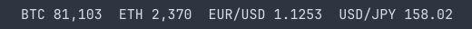

# Prices for Omarchy

An [Omarchy](https://omarchy.org) bar widget that shows FX rates and crypto prices.



- **Crypto** prices from [CoinGecko](https://www.coingecko.com), with the 24h change in the tooltip.
- **FX** rates live from Yahoo Finance, falling back to European Central Bank reference rates (via [Frankfurter](https://frankfurter.dev)) for any pair Yahoo can't supply. Any currency pair works.
- **Charts**: click the widget for a 24-hour or 7-day price chart of any ticker. Hover the chart to read the price at a point in time.

No API keys needed.

## Install

```bash
omarchy plugin add https://github.com/medden/omarchy-prices.git --enable
```

## Remove

```bash
omarchy plugin remove io.github.medden.prices
```

This deletes the plugin folder. If the widget is still listed in `~/.config/omarchy/shell.json`, delete its entry there too.

## Requirements

- Omarchy with the Quickshell-based shell
- `curl` (installed by default on Omarchy)
- Internet access to CoinGecko (`api.coingecko.com`), Yahoo Finance (`query1.finance.yahoo.com`) and Frankfurter (`api.frankfurter.dev`). No accounts or API keys.

## Usage

| Action | Result |
|---|---|
| Left click | Open the chart (on the ticker showing, when rotation is on) |
| Middle click | Refresh now |
| Hover | Full prices, 24h / daily change, and where each FX rate came from |
| Scroll | Step through tickers (when rotation is on) |

In the chart, click the chips or use ← / → (or `h` / `l`) to switch ticker and ↑ / ↓ (or `j` / `k`) to switch between 24h and 7d. `Esc` closes it.

If a refresh fails, the last prices stay up and the tooltip says so.

## Settings

Add settings to the widget's entry in `~/.config/omarchy/shell.json`. The bar picks up changes when you save.

```json
{
  "id": "io.github.medden.prices",
  "crypto": "bitcoin,ethereum,solana",
  "vsCurrency": "usd",
  "fxPairs": "EUR/USD,USD/JPY",
  "refreshMinutes": 5,
  "rotateSeconds": 0
}
```

| Key | Default | Meaning |
|---|---|---|
| `crypto` | `bitcoin,ethereum` | CoinGecko coin ids, comma-separated (the last part of the coin's coingecko.com URL). `""` hides crypto. |
| `vsCurrency` | `usd` | Currency crypto prices are quoted in. |
| `fxPairs` | `EUR/USD,GBP/USD` | `BASE/QUOTE` pairs, comma-separated. `""` hides FX. |
| `refreshMinutes` | `5` | How often to fetch prices. |
| `rotateSeconds` | `0` | `0` shows every ticker at once; any other value shows one ticker at a time, switching every that many seconds. |

On a vertical bar the widget shows `$`; prices are in the tooltip.

## Notes

- **FX prices and charts come from Yahoo Finance's chart data.** It's unofficial and could stop working without notice. If Yahoo has no quote for a pair, or its last quote is more than 30 minutes old (or three refresh intervals, if longer), the bar shows the ECB reference rate instead, and the tooltip says which source each rate came from. ECB rates update once per business day, around 16:00 CET.
- FX markets close at weekends, so FX prices stop moving then. The 24h chart shows the last trading session and says so.
- The chart's dashed line is the price at the start of the range.
- **CoinGecko's free API is rate limited per IP address.** The default 5-minute refresh is comfortable; very short intervals, or several monitors (the widget fetches once per monitor), can hit the limit. Failed fetches retry after a minute, and the last prices stay up meanwhile.
- After updating the plugin, run `omarchy restart shell` if the bar doesn't pick up the new version.
- From a script: `omarchy-shell io.github.medden.prices refresh`, or `open` / `close` / `toggle` for the chart.

## License

MIT
